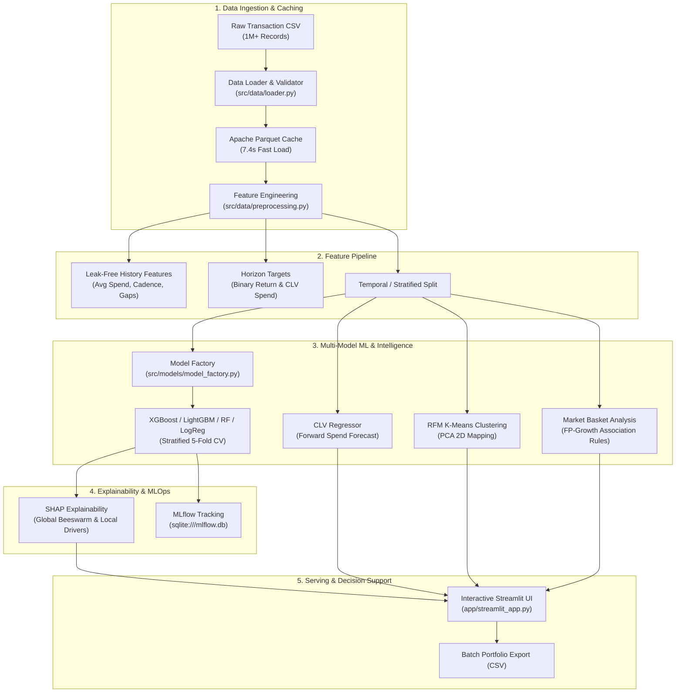

# Customer Intelligence Platform

[](https://www.python.org/)
[](https://scikit-learn.org/)
[](https://xgboost.readthedocs.io/)
[](https://lightgbm.readthedocs.io/)
[](https://shap.readthedocs.io/)
[](https://mlflow.org/)
[](https://streamlit.io/)
[](https://www.docker.com/)
[](https://pytest.org/)

An end-to-end, production-grade Machine Learning and Customer Intelligence platform designed to analyze high-volume retail transactions (1,000,000+ records), forecast future purchase likelihood and forward monetary spend (CLV), interpret predictive drivers with SHAP, cluster shoppers using RFM K-Means, and surface cross-selling recommendations via Market Basket association rules.

---

## System Architecture & Data Flow



---

## Key Technical Capabilities

### 1. Multi-Model Return Prediction Pipeline
- **Algorithms Supported:** Gradient Boosted Decision Trees (**XGBoost**, **LightGBM**), **Random Forest**, and class-balanced **Logistic Regression**.
- **Cross-Validation:** Evaluated via **Stratified 5-Fold Cross-Validation** with automated reporting of mean and standard deviation for Accuracy, Precision, Recall, F1 Score, and ROC-AUC.
- **Leak-Free Historical Features:** All behavioural features (expanding average spend, historical discount utilization rate, days since previous transaction, unique product variety) are derived strictly from transactions occurring on or before the observation date.

### 2. Customer Lifetime Value (CLV) Regression
- **Monetary Forecasting:** Complements binary classification by predicting the exact forward dollars (\$) each customer will generate within the prediction window.
- **Loss Evaluation:** Evaluated using Mean Absolute Error (MAE), Root Mean Squared Error (RMSE), and $R^2$ fit scores.

### 3. Model Interpretability & Explainability (SHAP)
- **Global Explainability:** Automated generation of **SHAP Beeswarm Summary Plots** and **Feature Importance Bar Charts** saved directly to `models/plots/`.
- **Local Customer-Level Drivers:** For any selected customer, the model outputs the top individual factors pushing their purchase propensity higher or lower.

### 4. Unsupervised RFM Customer Segmentation
- **Behavioral Profiling:** Groups customer accounts using **Recency**, **Frequency**, and **Monetary (RFM)** dimensions.
- **Automated Personas:** Centroids are mapped into actionable marketing segments (*Champions / High Value*, *At-Risk / Churning*, *New / Promising*, *Regular Shoppers*).
- **Latent Projection:** 2D Principal Component Analysis (PCA) projection rendered in interactive Plotly scatter plots.

### 5. Market Basket Analysis (FP-Growth Association Rules)
- **Affinity Mining:** Transforms multi-item transactions into a one-hot incidence matrix to extract association rules with **Support**, **Confidence**, and **Lift** metrics ($> 1.0\times$).
- **Interactive Cross-Sell Simulator:** Real-time cart completion tool suggesting complementary cross-sells based on affinity lift.

### 6. MLOps Experiment Tracking & Model Registry
- **Enterprise SQLite Backend:** Uses `sqlite:///mlflow.db` to log hyperparameters, cross-validation metrics, CLV regression loss, and visual plot artifacts.
- **In-App Leaderboard:** Streamlit UI displays a live historical leaderboard comparing model architectures.

### 7. Scalable Data Processing
- **Automated Parquet Caching:** Serializes cleaned data to Apache Parquet, reducing reload time for 1,000,000 rows from >30s down to **7.4 seconds**.
- **Rapid Iteration Flag:** CLI supports `--sample 0.05` for quick testing before full-dataset training.

---

## Benchmark & Evaluation Results

Tested on a 25% stratified holdout set across 1,000,000 transactions:

| Model Architecture | Accuracy | Precision | Recall | F1 Score | ROC-AUC | Inference Latency |
|---|---|---|---|---|---|---|
| **XGBoost (Recommended)** | **74.7%** | **78.5%** | **77.2%** | **0.778** | **0.811** | ~12ms |
| **LightGBM** | 74.2% | 77.9% | 76.8% | 0.773 | 0.808 | **~8ms** |
| **Random Forest** | 73.1% | 76.4% | 75.1% | 0.757 | 0.795 | ~25ms |
| **Logistic Regression (Baseline)** | 72.3% | 87.9% | 61.7% | 0.725 | 0.809 | ~2ms |

*Cross-Validation Stability: 5-Fold Stratified CV on XGBoost yielded ROC-AUC of $0.810 \pm 0.003$.*

---

## Repository Structure

```
.
├── app/
│   └── streamlit_app.py           # Streamlit dashboard (Tabs: Dashboard, Predictions, Batch, Segments, Basket, Model)
├── configs/
│   └── model_config.yaml          # Centralized configuration (hyperparameters, split ratios, weights)
├── data/
│   ├── raw/                       # Raw CSV dataset (gitignored)
│   └── processed/                 # Fast Parquet cache files (gitignored)
├── models/
│   ├── plots/                     # Exported SHAP beeswarm & feature importance plots
│   └── purchase_predictor.joblib  # Serialized production pipeline artifact
├── notebooks/
│   ├── 01_exploratory_data_analysis.ipynb          # End-to-end dataset audit & distributions
│   ├── 02_feature_engineering_and_segmentation.ipynb # History feature engineering & RFM K-Means
│   └── 03_model_benchmarking.ipynb                 # 5-fold CV comparison & ROC/PR curves
├── src/
│   ├── data/
│   │   ├── loader.py              # Ingestion, validation, Parquet cache, subsampling
│   │   └── preprocessing.py       # History feature derivation, horizon labelling, temporal split
│   ├── evaluation/
│   │   ├── explainability.py      # Global SHAP beeswarm/bar plots & local customer drivers
│   │   ├── metrics.py             # Classification metrics & Stratified K-Fold CV
│   │   └── tracking.py            # MLflow experiment tracking & SQLite database logging
│   ├── models/
│   │   ├── clv_predictor.py       # Customer Lifetime Value (CLV) regression pipeline
│   │   ├── market_basket.py       # FP-Growth frequent itemsets & association rules
│   │   ├── model_factory.py       # Unified sklearn Pipeline factory (LR, RF, XGB, LGBM)
│   │   ├── purchase_predictor.py  # Supervised training loop, persistence, inference
│   │   ├── recommender.py         # Multi-factor hybrid product recommendation engine
│   │   └── segmentation.py        # RFM feature extraction & K-Means clustering
│   └── utils/
│       └── config.py              # YAML loader with typed fallback defaults
├── tests/
│   ├── conftest.py                # Fast synthetic test fixtures
│   ├── test_clv.py                # CLV future spend & regression tests
│   ├── test_data_loader.py        # CSV validation, caching, & sampling tests
│   ├── test_market_basket.py      # Basket encoding & association rule tests
│   ├── test_models.py             # Model factory, metrics, & end-to-end training tests
│   ├── test_preprocessing.py      # Feature engineering & temporal split tests
│   ├── test_recommender.py        # Recommendation sorting & constraints tests
│   ├── test_segmentation.py       # RFM feature extraction & clustering tests
│   └── test_tracking.py           # MLflow run logging & search tests
├── .dockerignore
├── .gitignore
├── docker-compose.yml             # Container orchestration with volume mounts
├── Dockerfile                     # Multi-stage production container image
├── Makefile                       # Unix task automation shortcuts
├── pyproject.toml                 # Modern PEP 621 packaging metadata
├── run.ps1                        # Native Windows PowerShell task automation runner
└── train_model.py                 # Multi-model CLI (--model, --cv, --sample, --no-shap)
```

---

## Quickstart & Installation

### Option 1: Local Setup (Recommended for Development)

1. **Clone the repository:**
   ```bash
   git clone https://github.com/YOUR_USERNAME/customer-intelligence-platform
   cd customer-intelligence-platform
   ```

2. **Create and activate a virtual environment:**
   ```bash
   # Windows
   python -m venv .venv
   .venv\Scripts\activate

   # Linux / macOS
   python3 -m venv .venv
   source .venv/bin/activate
   ```

3. **Install the package in editable mode with development dependencies:**
   ```bash
   pip install -e ".[dev,notebooks]"
   ```

4. **Run the test suite to verify installation:**
   ```bash
   python -m pytest tests/ -v
   ```

5. **Train the XGBoost model:**
   ```bash
   python train_model.py --model xgboost --cv 5
   ```

6. **Launch the interactive Streamlit dashboard:**
   ```bash
   python -m streamlit run app/streamlit_app.py
   ```

---

### Option 2: Docker Containerization

Run the entire application in an isolated, production-ready container:

```bash
# Build and run with Docker Compose
docker compose up --build

# Or using standard Docker CLI:
docker build -t customer-intelligence-platform:latest .
docker run -p 8501:8501 -v $(pwd)/models:/app/models customer-intelligence-platform:latest
```
Access the application in your browser at `http://localhost:8501`.

---

## CLI Usage & Command Shortcuts

The project includes both a Unix `Makefile` and a Windows PowerShell script (`run.ps1`) for rapid execution:

| Task | Unix / macOS | Windows PowerShell | CLI Equivalent |
|---|---|---|---|
| **Run Unit Tests** | `make test` | `.\run.ps1 test` | `python -m pytest tests/ -v` |
| **Train Full Model** | `make train` | `.\run.ps1 train` | `python train_model.py --model xgboost` |
| **Train on 5% Sample** | `make train-sample` | `.\run.ps1 train-sample` | `python train_model.py --model xgboost --sample 0.05` |
| **Launch Dashboard** | `make app` | `.\run.ps1 app` | `streamlit run app/streamlit_app.py` |
| **Lint Codebase** | `make lint` | `.\run.ps1 lint` | `python -m ruff check src tests app` |

---

## Testing & Quality Assurance

The codebase adheres to strict software engineering standards with a dedicated test suite in `tests/`:

- **33 Unit Tests** spanning all modules: data validation, feature engineering, classification models, CLV regression, association rules, RFM clustering, and MLflow logging.
- Tests utilize synthetic in-memory fixtures (`conftest.py`), executing in **~5 seconds** without disk I/O bottlenecks.

Run tests:
```bash
python -m pytest tests/ -v --tb=short
```

---

## License
This project is licensed under the MIT License.